# RAD-QA

RAD-QA es una aplicación de escritorio para el control de calidad de los equipos de radioterapia, braquiterapia y tomografía de un servicio de física médica. Registra los controles diarios, mensuales y anuales, analiza imágenes y películas, hace los cálculos físicos asociados, genera los reportes en PDF y deja rastro de cada acción de los usuarios.

Está escrita en Python con PyQt5 y guarda sus datos en una base SQLite local. Está pensada para servicios de física médica y se despliega en ordenadores de acceso controlado. El proyecto está en desarrollo activo (ver [Estado del proyecto](#estado-del-proyecto)).

## Contenido

- [Qué hace](#qué-hace)
- [Recorrido por la aplicación](#recorrido-por-la-aplicación)
- [Estado del proyecto](#estado-del-proyecto)
- [Requisitos e instalación](#requisitos-e-instalación)
- [Para desarrolladores](#para-desarrolladores)
- [Documentación adicional y referencias](#documentación-adicional-y-referencias)
- [Licencia y contacto](#licencia-y-contacto)

---

## Qué hace

- Registra los controles de calidad diarios, mensuales y anuales de los aceleradores lineales, los diarios y mensuales de la braquiterapia HDR y el mensual del tomógrafo.
- Analiza imágenes: el fantoma Catphan 504 en formato DICOM, las películas radiocrómicas, el colimador multiláminas (MLC, con las pruebas Picket Fence y Starshot) y los perfiles de haz de PTW (archivos .mcc).
- Calcula magnitudes físicas: la dosis de referencia con el protocolo TRS-398 del OIEA, la actividad de la fuente de Ir-192, la simetría, la planicidad, la calidad del haz y las unidades monitor (UM) según la ecuación 3 del informe TG-71 de la AAPM.
- Genera reportes en PDF, los muestra en un visor integrado y exporta tablas de la base a Excel.
- Gestiona usuarios, roles, un catálogo de equipos de medición con la vigencia de su calibración y referencias de calidad editables.
- Deja rastro de cada acción (quién, qué y cuándo). Los registros de los controles no se borran: se anulan, y lo anulado se consulta en un visor.

### Equipos y sistemas cubiertos

| Equipo o sistema | Controles | Análisis y herramientas propias |
|---|---|---|
| Clinac 600 | Diario, mensual, anual | MLC (Picket Fence y Starshot), película del campo luminoso, dosimetría con TRS-398, lectura de archivos .mcc de PTW |
| Clinac iX | Diario, mensual, anual y sistema de imágenes (mensual y anual) | Las del Clinac 600, más control de conos y tomografía de haz cónico (CBCT) con Catphan |
| Halcyon | Diario, mensual, anual y sistema de imágenes (mensual y anual) | Lectura de los reportes MPC del equipo y CBCT con Catphan |
| Braquiterapia HDR (Gammamed Plus iX, Ir-192) | Diario y mensual (control mensual y cambio de fuente; calibración redundante y linealidad desde «Cal. Fuente») | Actividad de la fuente, posición inicial con película, análisis de la imagen del diario |
| Tomógrafo (Siemens SOMATOM go.Sim) | Mensual | Catphan 504 en siete categorías de análisis más los cortes de referencia |

### Alcance y límites

- No planifica tratamientos. La calculadora de UM verifica de forma independiente el cálculo del planificador y no guarda ningún cálculo.
- No gestiona pacientes ni sus imágenes: las secciones «Pacientes» e «Imágenes» de la pantalla de selección están previstas y no están implementadas.
- Trabaja sobre una base local de un solo puesto: no es una aplicación web ni un servicio de red.
- Las contraseñas de los usuarios se guardan cifradas, y las acciones restringidas se comprueban en los servicios y no solo en la pantalla.

### Principios de diseño

- Cada control guarda el valor de referencia contra el que se juzgó, de modo que cambiar una referencia después no altera los controles ya guardados.
- Editar un valor deja registrado el anterior y el nuevo. Eliminar un control o reemplazar un bloque lo anula, no lo borra. La excepción es el catálogo de equipos de medición, cuyo botón «Eliminar» borra la fila tras pedir la contraseña y dejar el detalle en la auditoría.
- Cada tabla tiene una única puerta de escritura en `services/`, y la lógica de cálculo no depende de la pantalla.

---

## Recorrido por la aplicación

Al iniciar, la aplicación pide usuario y contraseña y luego muestra la pantalla de selección de actividad. Desde ahí se abre la ventana principal, que organiza todo en doce pestañas: 600, iX, Halcyon, Braquiterapia, Tomógrafo, Equipos, Excel, Registros, Visor BD, Usuarios, Referencias y Calculadora UM. Cada pestaña de equipo tiene un menú lateral con las pruebas de ese equipo (Diaria, Mensual, Anual, Imágenes Mensual e Imágenes Anual, Cal. Fuente, Posición inicial), además de «Cerrar control» e «Inicio». La ventana se titula «Graficador de pruebas».

### Controles diarios

El diario del Clinac 600 y del iX es un formulario por secciones (seguridad, aspectos mecánicos, aspectos dosimétricos y observaciones). El de braquiterapia tiene seguridad, aspectos dosimétricos y observaciones, y el del Halcyon se organiza por los grupos de los reportes MPC. Todos incluyen una gráfica de tendencia de la magnitud elegida y la tabla de registros guardados.

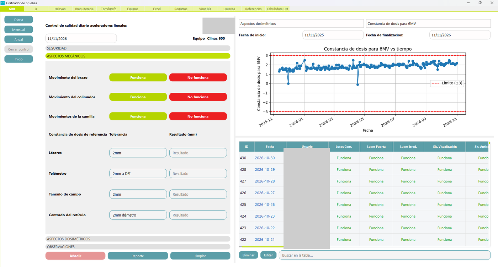

*Figura 1. Control diario del Clinac 600: aspectos mecánicos, constancia de dosis y tabla de registros.*

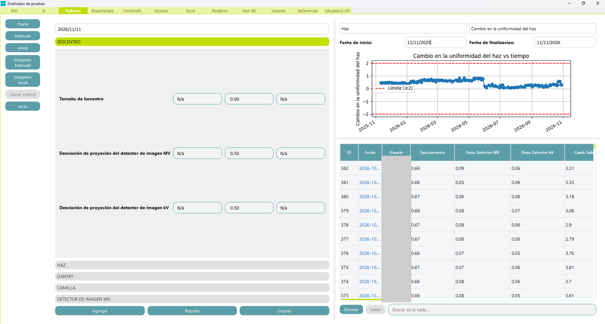

*Figura 2. Control diario del Halcyon: isocentro, gráfica de uniformidad del haz y registros.*

En braquiterapia, el diario calcula la actividad esperada de la fuente por decaimiento y la compara con la reportada, y analiza la película del diario: detecta las líneas, mide sus distancias y la alineación del campo.

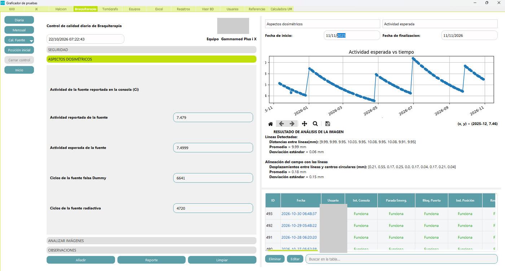

*Figura 3. Control diario de braquiterapia: actividad de la fuente, su gráfica y registros.*

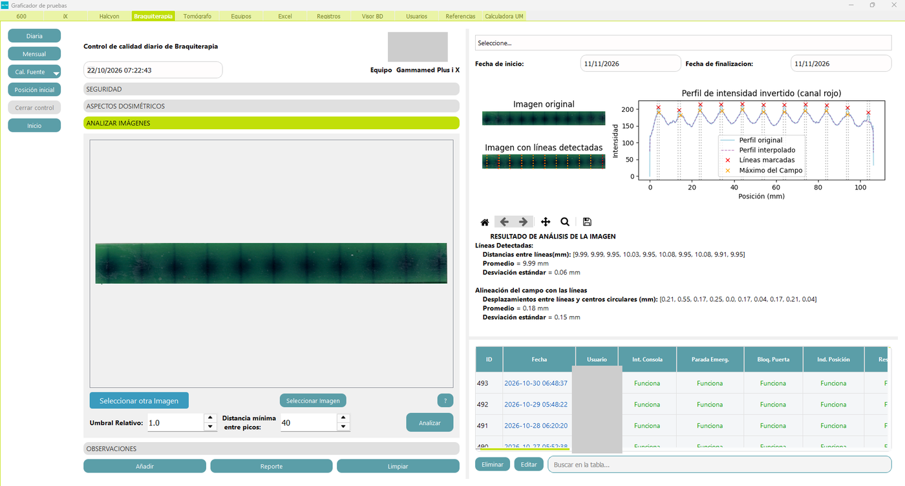

*Figura 4. Control diario de braquiterapia: líneas detectadas en la película y perfil de intensidad.*

### Controles mensuales

Los controles mensuales se organizan por bloques (equipos de medición, mecánicos, dosimetría, cuñas o conos, MLC y película). Cada bloque se guarda por separado y el control completo genera su reporte en PDF. En braquiterapia, «Mensual» cubre el control mensual y el cambio de fuente, con las lecturas del máximo de la cámara de pozo, los factores de corrección y la actividad calculada.

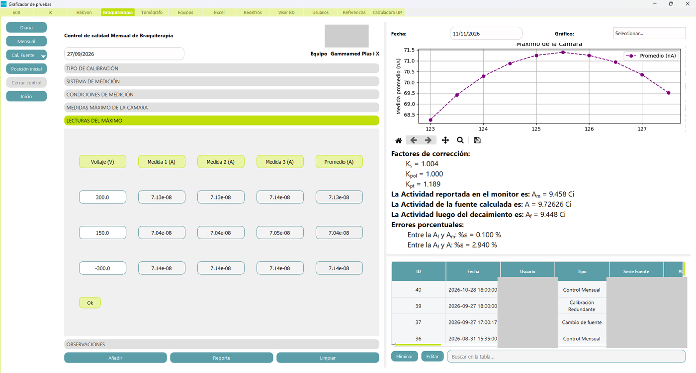

*Figura 5. Control mensual de braquiterapia: lecturas del máximo, factores de corrección y actividad de la fuente.*

### Tomografía y fantoma Catphan

El control mensual del tomógrafo analiza el fantoma Catphan 504 a partir de una carpeta DICOM. Antes de medir, la aplicación lee los datos de la adquisición y los compara con el protocolo exigido para el equipo.

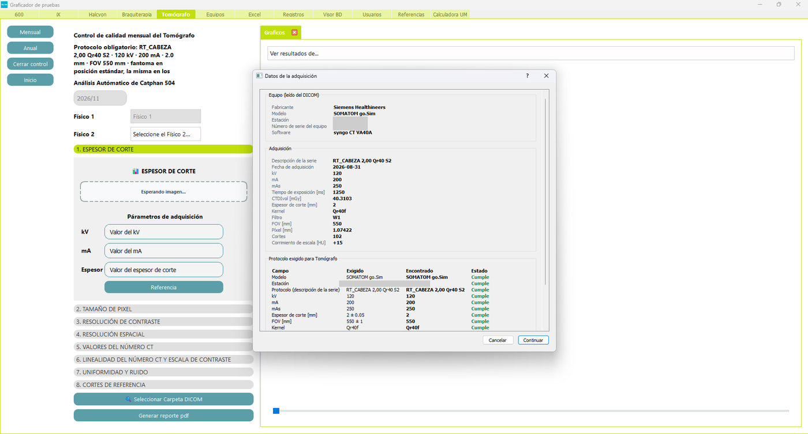

*Figura 6. Datos de la adquisición leídos del DICOM y comparación con el protocolo del tomógrafo.*

El análisis se hace por categorías y sugiere el corte recomendado para cada módulo del fantoma.

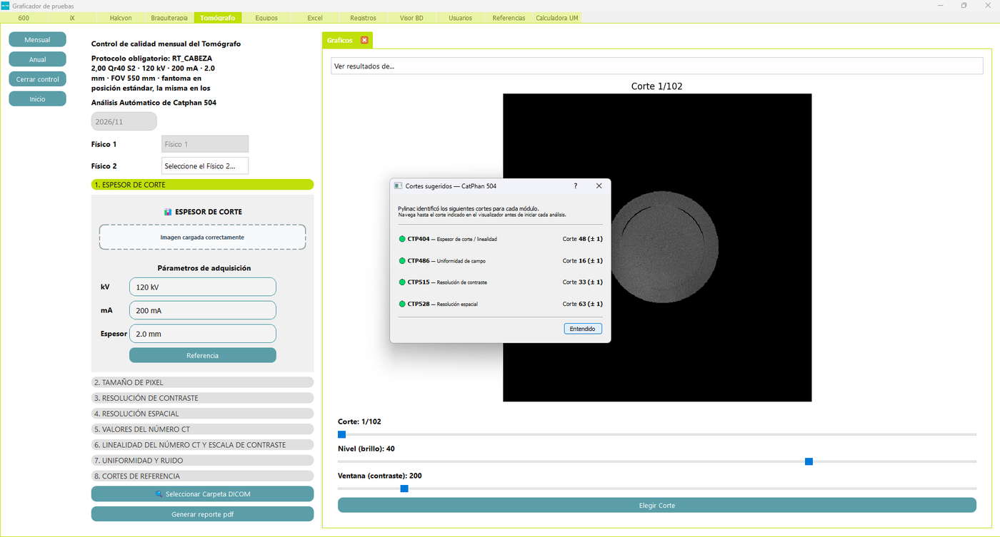

*Figura 7. Cortes sugeridos para cada módulo del fantoma Catphan 504.*

Los resultados se muestran con sus gráficas y valores, comparados con los criterios del equipo.

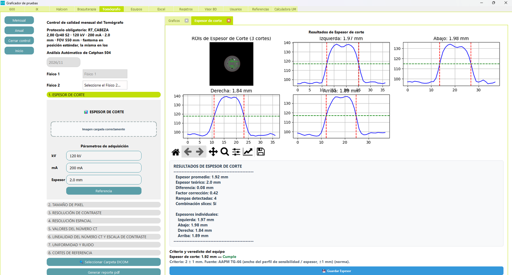

*Figura 8. Espesor de corte: perfiles, valores y criterio del equipo.*

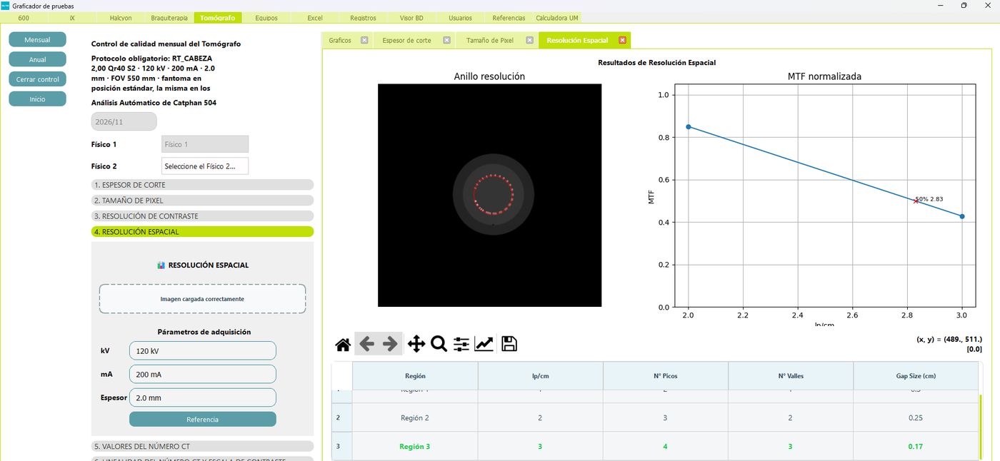

*Figura 9. Resolución espacial: anillo del fantoma, curva de la función de transferencia de modulación (MTF) y tabla de regiones.*

### Análisis de películas radiocrómicas

En el control mensual del Clinac 600 y del iX, la película del campo luminoso se analiza en una ventana propia: se marcan las cuatro esquinas del campo y el retículo, y la aplicación mide el campo de radiación y lo compara con el luminoso. La base del análisis es la densidad óptica neta. La ventana tiene cinco pestañas:

1. **Imagen:** la película con los puntos marcados y la tabla de medidas.
2. **Capas:** las tres capas de color de la película en densidad óptica.
3. **Perfiles por capa:** el perfil de cada capa con su ancho a media altura (FWHM).
4. **Barridos:** el ancho del campo medido banda por banda en cada eje.
5. **Cuadratura:** el campo marcado frente a un cuadrado perfecto de 100 mm.

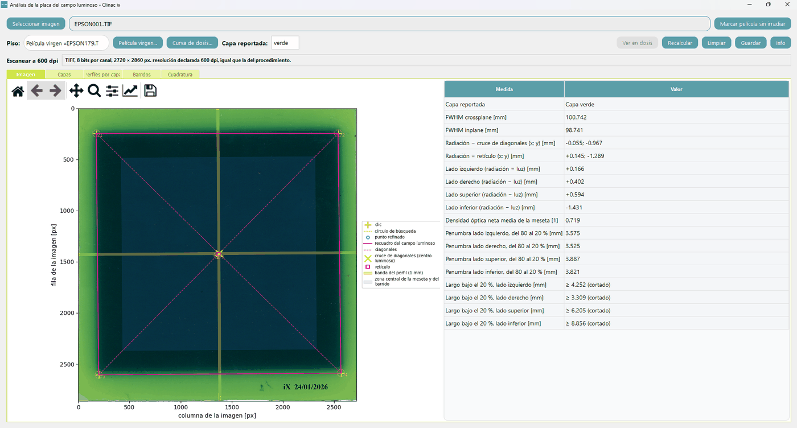

*Figura 10. Pestaña Imagen: película con los puntos marcados y tabla de medidas.*

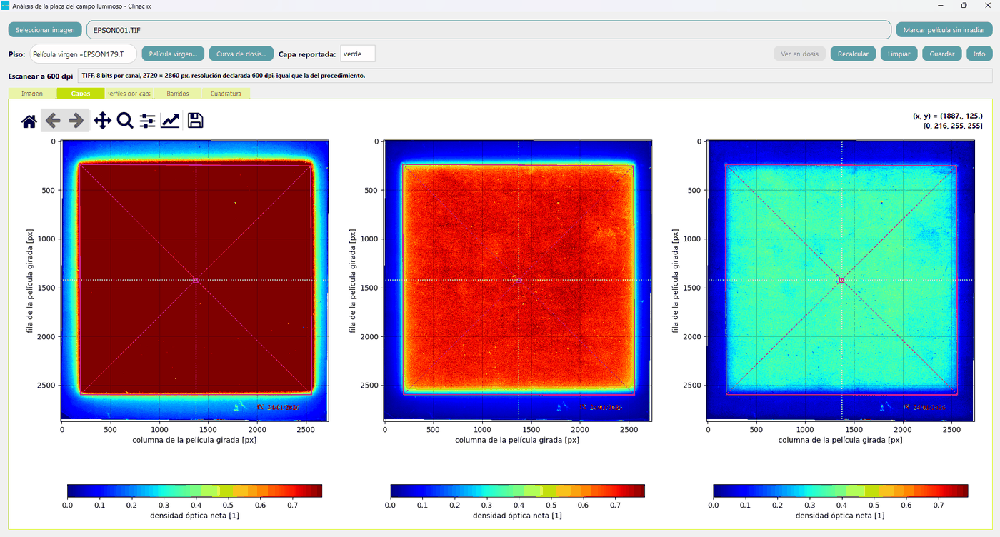

*Figura 11. Pestaña Capas: las tres capas de color en densidad óptica.*

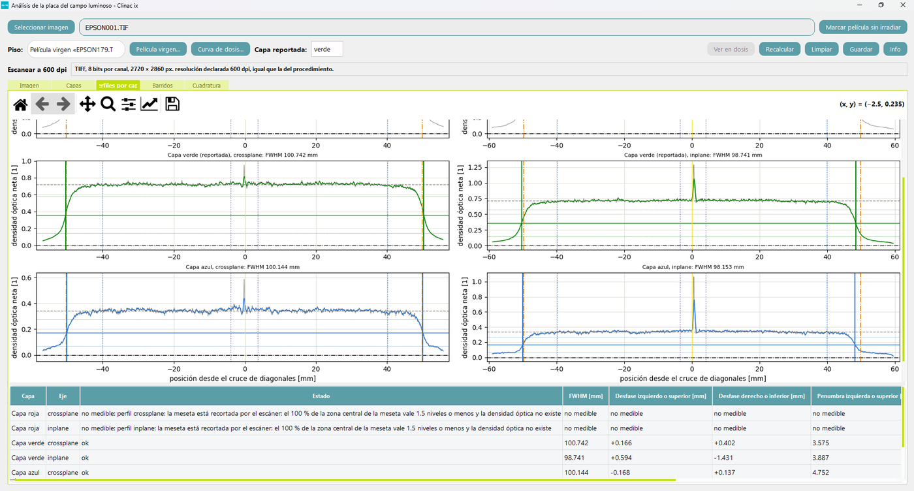

*Figura 12. Pestaña Perfiles por capa: perfiles con su ancho a media altura.*

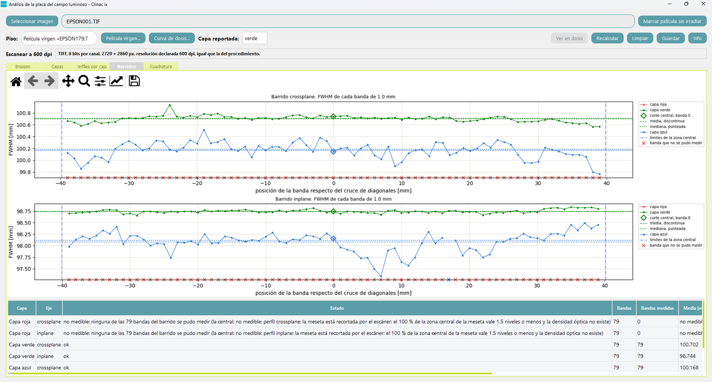

*Figura 13. Pestaña Barridos: ancho del campo banda por banda en cada eje.*

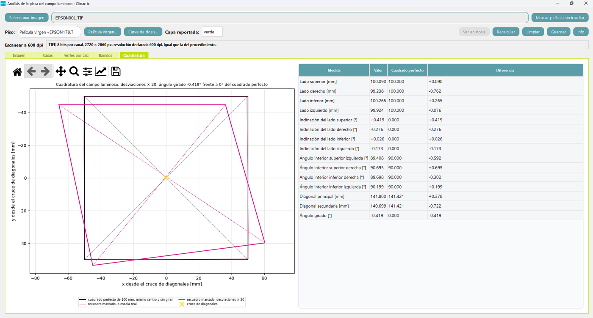

*Figura 14. Pestaña Cuadratura: el campo marcado frente a un cuadrado perfecto de 100 mm.*

### Equipos de medición

El catálogo guarda cámaras de ionización, cámaras de pozo, electrómetros y otros instrumentos, con su factor y fecha de calibración y el certificado. La vigencia se calcula en el momento de usarla: contra la fecha del control que se está llenando en los formularios, y contra la fecha de hoy en el catálogo.

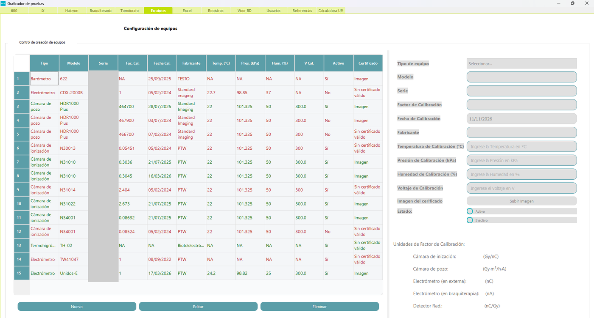

*Figura 15. Catálogo de equipos de medición con su formulario de alta y edición.*

### Calculadora independiente de unidades monitor

Una pestaña aparte calcula las UM con la ecuación 3 de la TG-71 a partir de las tablas que exporta Eclipse, muestra el desglose factor por factor y las compara con las UM del planificador. La subpestaña «Desde JSON» está reservada para la importación de planes, que todavía está en desarrollo.

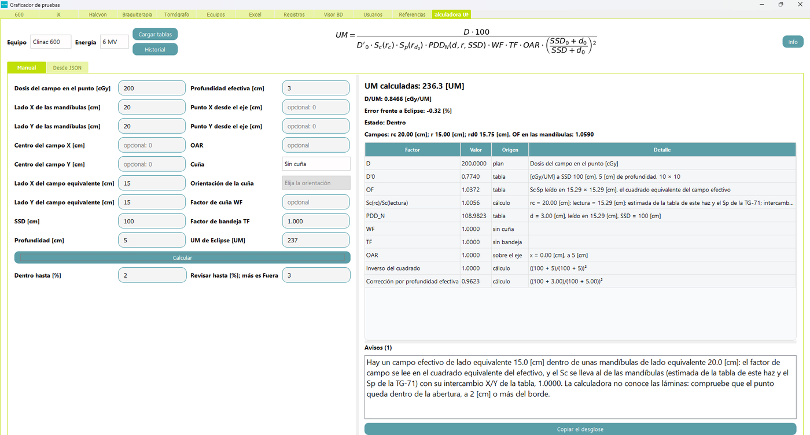

*Figura 16. Calculadora de UM (TG-71): formulario manual y desglose de cada factor.*

### Otras pestañas

- **Excel:** exporta a un archivo .xlsx una tabla de la base, con rango de fechas y nombres de columna legibles.
- **Registros:** bitácora de acciones (inicios de sesión, guardados, ediciones y respaldos) con filtro.
- **Visor BD:** visor de solo lectura de los registros anulados y su rastro de auditoría.
- **Usuarios:** cuentas del personal con su rol y estado. Dar de baja, reactivar y cambiar el rol exigen ser administrador o físico jefe.
- **Referencias:** valores de referencia de calidad por equipo y energía, con su historial de cambios. Todos los ven; solo el administrador y el físico jefe los fijan.

---

## Estado del proyecto

El proyecto está en desarrollo activo.

- **Implementado:** controles diarios, mensuales y anuales; análisis Catphan; MLC; películas radiocrómicas con densidad óptica y curva de dosis; actividad de la fuente de braquiterapia; calculadora de dosis; reportes PDF; usuarios, auditoría y respaldos.
- **Calculadora de UM:** la parte manual y la carga de tablas de Eclipse están disponibles. El lector de planes en JSON existe como servicio y su pantalla está en desarrollo.
- **Previsto y sin implementar:** las secciones «Pacientes» e «Imágenes» de la pantalla de selección de actividad.

---

## Requisitos e instalación

### Requisitos

- Python 3.11.
- Windows para compilar y usar el ejecutable. El desarrollo y las pruebas también corren en Linux.
- Dependencias fijadas en `requirements.txt`. La pila principal es PyQt5 y pyqtgraph (interfaz); NumPy, SciPy y pandas (cálculo); OpenCV, scikit-image y Pillow (imágenes); pydicom y pylinac (DICOM, Catphan y MLC); matplotlib (gráficas); ReportLab y PyMuPDF (PDF); openpyxl, xlrd y msoffcrypto-tool (Excel y hojas del OIEA); pyAesCrypt (cifrado de contraseñas); y pywin32, que se instala solo en Windows.

### Instalación para desarrollo

En Linux, desde la raíz del repositorio:

```bash
python3.11 -m venv .venv
.venv/bin/python -m pip install --upgrade pip
.venv/bin/python -m pip install -r requirements.txt
```

En Windows (PowerShell):

```powershell
py -3.11 -m venv .venv
.\.venv\Scripts\python.exe -m pip install --upgrade pip
.\.venv\Scripts\python.exe -m pip install -r requirements.txt
```

### Ejecución

En Linux:

```bash
.venv/bin/python main.py
```

En Windows (PowerShell):

```powershell
.\.venv\Scripts\python.exe main.py
```

- La base de datos `BaseDatosQA.db` no viaja en el repositorio. La aplicación la busca en la raíz del proyecto cuando se ejecuta desde el código y junto al ejecutable cuando está empaquetada. Si no existe, la aplicación crea una base vacía en esa ruta, con una cuenta de administrador inicial; las credenciales las administra quien instala.
- Las excepciones no capturadas quedan en `error_log.txt`, en la raíz del proyecto o junto al ejecutable. El ejecutable se compila sin consola, por eso este archivo es necesario.

### Compilar el ejecutable (solo Windows)

PyInstaller no compila de forma cruzada y el script usa el separador de rutas de Windows. No debe compilarse dentro de carpetas sincronizadas en tiempo real (OneDrive, Dropbox): provoca fallos de compilación.

```powershell
.\.venv\Scripts\python.exe -m pip install pyinstaller==6.21.0
Remove-Item -Recurse -Force build, dist -ErrorAction SilentlyContinue
.\.venv\Scripts\python.exe build_exe.py
```

El resultado queda en `dist\RAD-QA\RAD-QA.exe`. Es una compilación de tipo carpeta: se distribuye `dist\RAD-QA\` completa, con su subcarpeta `_internal\`.

---

## Para desarrolladores

### Estructura del proyecto

```text
RAD-QA-AUNA/
├── main.py                       Punto de entrada: inicio de sesión, selección y ventana principal
├── build_exe.py                  Compilación con PyInstaller (solo Windows)
├── utils.py                      resource_path(): rutas de recursos, también dentro del ejecutable
├── requirements.txt              Dependencias fijadas
├── requirements-dev.txt          Dependencias de desarrollo (pytest)
├── pytest.ini                    Configuración de las pruebas
├── RUNBOOK_MIGRAR_BD.md          Guía para llevar una base antigua al esquema actual
├── RevisionDeSeguridad.md        Comandos para revisar el repositorio (Socket, Gitleaks, Bandit)
│
├── ui/                           Interfaz de usuario (PyQt5)
│   ├── mainpages.py              Ventana principal, pestañas y menú lateral por equipo
│   ├── paginasEntrReg/           Inicio de sesión, registro y recuperación
│   ├── paginasGuia/              Selección de actividad y pestañas de gestión:
│   │                             equipos, Excel, registros, visor de anulados, usuarios,
│   │                             referencias y calculadora de UM
│   └── paginasControles/         Páginas de los controles
│       ├── PruebasDiarias/       Diarios (clase base PruebaBasico, 600, iX, Halcyon, braquiterapia)
│       ├── PruebasMensuales/     Mensuales, imágenes, película, curva de dosis y Catphan
│       └── PruebasAnuales/       Anuales
│
├── services/                     Lógica de negocio sin pantalla: auditoría y anulación,
│                                 permisos, respaldo, equipos, dosis, referencias, MLC,
│                                 películas y calculadora de UM
├── analisisImagenes/             Motores de análisis de imagen y sus dibujos
│   └── catphan/                  Motor Catphan basado en pylinac, perfiles y protocolos por equipo
├── data/
│   ├── widgets.xlsx              Definición de los widgets de cada pantalla
│   ├── ManejoDatos/              Conexión a la base, guardado y lectura, usuarios, Catphan
│   └── GraficasyTablas/          Tablas y gráficas
├── models/
│   └── PDF/                      Generación de reportes con ReportLab y visor de PDF
├── resources/                    Estilos, iconos, imágenes y datos de apoyo en JSON
├── mcc_PTW_read/                 Lector de archivos .mcc de PTW
├── scripts/                      Herramientas de línea de comandos, entre ellas la migración de la base
└── tests/                        Suite de pruebas con pytest
```

### Flujo de la aplicación

1. `main.py` abre la pantalla de inicio de sesión (`ui/paginasEntrReg/Login.py`).
2. Con la sesión iniciada se muestra la selección de actividad (`ui/paginasGuia/selection_page.py`). Hoy solo está activa la sección Pruebas.
3. «Pruebas» abre la ventana principal (`ui/mainpages.py`), con una pestaña por equipo y las pestañas de gestión.
4. En una prueba se cargan los datos o las imágenes, se ejecuta el análisis (`analisisImagenes/` y `services/`), se guarda en la base con su rastro de auditoría (`data/ManejoDatos/load.py`) y se genera el reporte PDF (`models/PDF/`).
5. Al cerrar la ventana se hace una copia de seguridad de la base.

### Base de datos, trazabilidad y respaldos

- **Motor:** SQLite, con modo WAL y claves foráneas activas. `data/ManejoDatos/conection.py` crea y actualiza las tablas al arrancar (más de setenta).
- **Anulación en lugar de borrado:** las tablas de los controles de calidad tienen una columna de vigencia. Eliminar o reemplazar un bloque lo anula, y el registro anterior queda disponible en el visor de anulados.
- **Auditoría:** cada acción de usuario escribe una fila en `audit_log` (usuario, acción, tabla, referencia y detalle).
- **Respaldo automático:** al cerrar la aplicación se copia la base en `respaldos_bd/`, junto a la base, con a lo sumo una copia por franja del día; se conservan las diez más recientes.
- **Migración:** `scripts/migrar_bd_a_estandar.py` lleva una base antigua al esquema actual. Por omisión solo simula; con `--aplicar` hace una copia con fecha, verifica la integridad antes y después y es idempotente. La guía de uso está en `RUNBOOK_MIGRAR_BD.md`.
- **Copias manuales:** deben copiarse juntos el archivo `.db` y sus archivos `-wal` y `-shm`, o cerrar antes la aplicación, que consolida el modo WAL al cerrar.

### Pruebas automáticas

La suite usa pytest e incluye más de 16 000 pruebas, repartidas en cientos de archivos dentro de `tests/`.

En Linux:

```bash
.venv/bin/python -m pip install -r requirements-dev.txt
QT_QPA_PLATFORM=offscreen .venv/bin/python -m pytest
```

En Windows (PowerShell):

```powershell
.\.venv\Scripts\python.exe -m pip install -r requirements-dev.txt
$env:QT_QPA_PLATFORM='offscreen'; .\.venv\Scripts\python.exe -m pytest
```

- `QT_QPA_PLATFORM=offscreen` permite ejecutar los componentes gráficos sin pantalla.
- `tests/conftest.py` sustituye la base real por una temporal y registra las lecturas de las tablas de control de calidad para comprobar que distinguen siempre el registro vigente.
- Un archivo suelto se ejecuta con `pytest tests/test_x.py`.
- Parte de las pruebas usa bases de referencia y archivos clínicos reales que no se publican; en un clon limpio esas pruebas se omiten.
- El repositorio usa pre-commit con tres controles activos: validación de YAML, límite de tamaño de archivos (500 KB, y 1 MB en `tests/datos/`) y búsqueda de secretos con gitleaks. Requiere tener instalados `pre-commit` y el binario `gitleaks`.

### Guía de trabajo

**Dónde vive cada cosa**

- **Páginas de control:** `PruebaBasico`, en `ui/paginasControles/PruebasDiarias/PruebasDiarias.py`, es la base común de los diarios, del mensual de braquiterapia y de `PruebaMensual600`. Esta última, en `ui/paginasControles/PruebasMensuales/seiscientos_mensual.py`, es la base de los mensuales y anuales de aceleradores, del tomógrafo y de las pantallas de imágenes; los anuales del iX y del Halcyon heredan de `PruebaAnual600`.
- **Widgets de las pantallas:** se definen en `data/widgets.xlsx`. Cada pantalla usa una hoja de encabezado (`encabezado_*`) y una de preguntas (`preguntas_*`); cada fila indica el nombre del widget, su tipo (campo de texto, lista desplegable, etiqueta, botón, fecha), el texto y su posición en la rejilla. Los lee `data/ManejoDatos/lectorWidgets.py`. Un widget que no aparece en el código se define en esa hoja.
- **Guardado y lectura de controles:** `data/ManejoDatos/load.py`. La conexión y el esquema están en `data/ManejoDatos/conection.py`.
- **Servicios:** cada tabla nueva tiene una única puerta de escritura en `services/`. Las escrituras de bloques de control de calidad pasan por `services/anulacion.py` (anular e insertar) y registran su acción con `services/audit_minimo.py`.
- **Análisis de imagen:** los motores nuevos (`placa_mensual`, `pelicula`, `posicion_inicial_braqui`, `curva_dosis` y `catphan/`) son funciones puras, separadas de sus dibujos (`dibujo_*.py`) y de la ventana que los muestra, para poder probarlos sin pantalla. Algunos módulos antiguos (`Analisis_PlacaRC.py`, `ActividadFuente.py`) todavía mezclan cálculo y gráfica; los análisis nuevos deben seguir el patrón de los nuevos.
- **Reportes:** `models/PDF/`, con un módulo por familia (diarios, mensuales, anuales, imágenes). Los diarios imprimen las columnas del diccionario de cada pantalla; `models/PDF/clasificacion_diario.py` declara las que no se imprimen en la tabla principal, y una prueba exige clasificar cualquier columna nueva de las tablas diarias.
- **Permisos:** `services/permisos.py`.

**Agregar un análisis de imagen**

1. Escribir el motor como funciones puras en `analisisImagenes/`, que reciban los datos y devuelvan un diccionario de resultados.
2. Separar los dibujos en un módulo aparte.
3. Si guarda datos, crear la tabla en `data/ManejoDatos/conection.py` y una puerta única de escritura en `services/`, anulando e insertando en lugar de sobrescribir y registrando la acción en la auditoría.
4. Conectarlo a la pantalla correspondiente en `ui/paginasControles/`.
5. Agregar pruebas en `tests/` con la base temporal de `tests/conftest.py`.

**Agregar un tipo de prueba o un equipo**

1. Definir las hojas de widgets del formulario en `data/widgets.xlsx`.
2. Crear la clase de la página heredando de `PruebaBasico` (diarios) o de `PruebaMensual600` (mensuales y anuales).
3. Agregar las tablas en `data/ManejoDatos/conection.py` y registrar las nuevas en el inventario de tablas anulables de `services/anulacion.py`.
4. Integrarla en el menú del equipo en `ui/mainpages.py`.
5. Declarar el reporte en `models/PDF/` y sumar los módulos nuevos a la lista de `build_exe.py`.

**Convenciones del código nuevo**

- Docstrings en las funciones públicas, en español, explicando el motivo y no solo el qué.
- Nombres según PEP 8: `snake_case` para funciones y variables, `PascalCase` para clases y `UPPER_CASE` para constantes.
- Imports en tres grupos: biblioteca estándar, terceros y módulos del proyecto.
- Los textos que ve el usuario van en español, con las unidades entre corchetes.

### Solución de problemas

- **La aplicación se cierra o una acción no hace nada:** revisar `error_log.txt` (ver [Ejecución](#ejecución)); ahí quedan las excepciones no capturadas y los errores que la aplicación atrapa sin avisar.
- **No se puede compilar el ejecutable:** ver [Compilar el ejecutable](#compilar-el-ejecutable-solo-windows). La versión de PyInstaller está fijada en 6.21.0.
- **Una copia de la base parece incompleta:** ver [Base de datos, trazabilidad y respaldos](#base-de-datos-trazabilidad-y-respaldos), punto sobre copias manuales.
- **Las pruebas gráficas se quedan esperando:** una ventana modal bajo `offscreen` bloquea el proceso sin lanzar una excepción. En las pruebas, los cuadros de diálogo se sustituyen por versiones simuladas.
- **El análisis del fantoma Catphan no detecta la geometría:** revisar que la carpeta DICOM sea una serie completa y que el contraste de la imagen sea suficiente. La geometría se detecta en `data/ManejoDatos/catphan_TAC/leer_dicom.py` y el motor basado en pylinac está en `analisisImagenes/catphan/`.

---

## Documentación adicional y referencias

### En el repositorio

- `RUNBOOK_MIGRAR_BD.md`: cómo ajustar una base de datos antigua al esquema actual.
- `RevisionDeSeguridad.md`: comandos para revisar el repositorio con Socket, Gitleaks y Bandit.

### Referencias de física médica

- AAPM TG-71: Gibbons J. P. y otros, «Monitor unit calculations for external photon and electron beams», Medical Physics 41(3), 2014. Base de la calculadora de UM.
- AAPM TG-142: Klein E. E. y otros, «Quality assurance of medical accelerators», Medical Physics 36(9), 2009. Base de los controles de aceleradores.
- OIEA, Informe Técnico n.º 398 (TRS-398), «Absorbed dose determination in external beam radiotherapy», 2000, y su revisión 1 de 2024. Base de la dosimetría de referencia.
- Documentación del fantoma Catphan 504 (The Phantom Laboratory) y de [pylinac](https://pylinac.readthedocs.io/).

---

## Licencia y contacto

- El repositorio no incluye un archivo de licencia. Antes de reutilizar el código, consultar a los autores.
- Para preguntas o para reportar errores, abrir una incidencia (issue) en el repositorio de GitHub.
